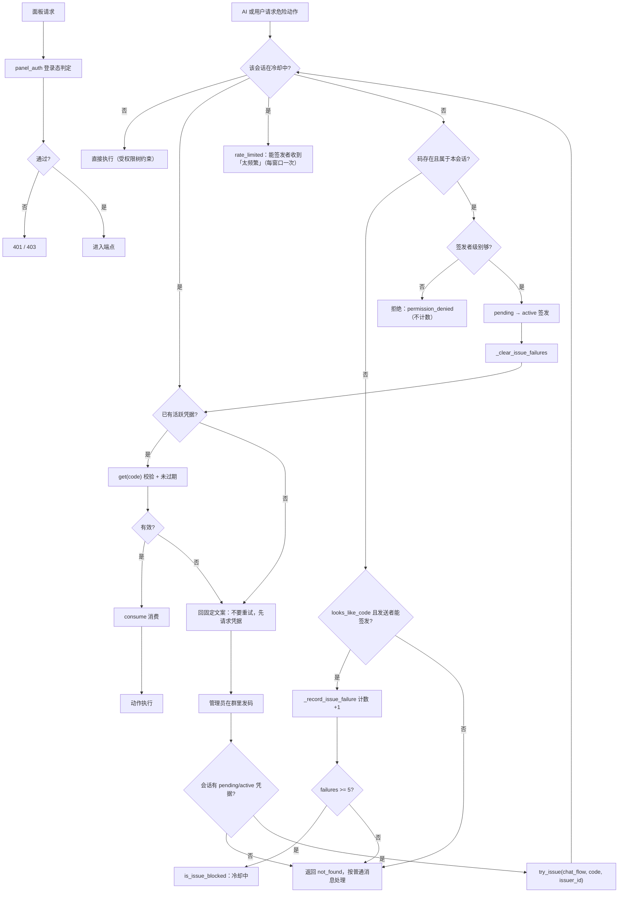
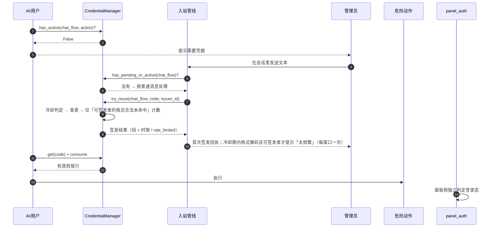
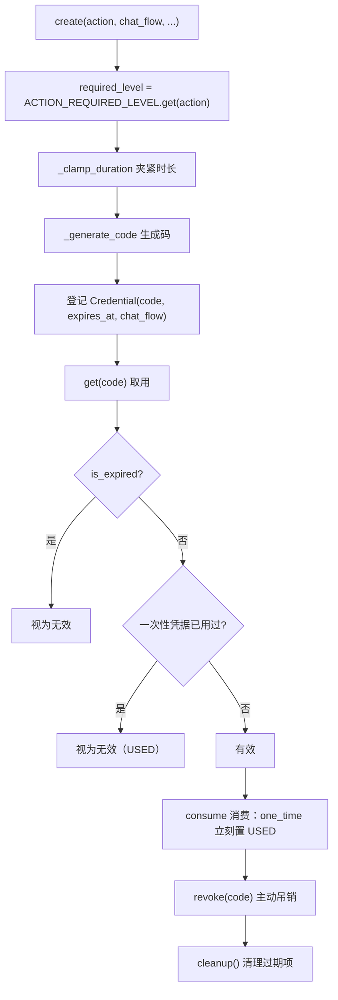
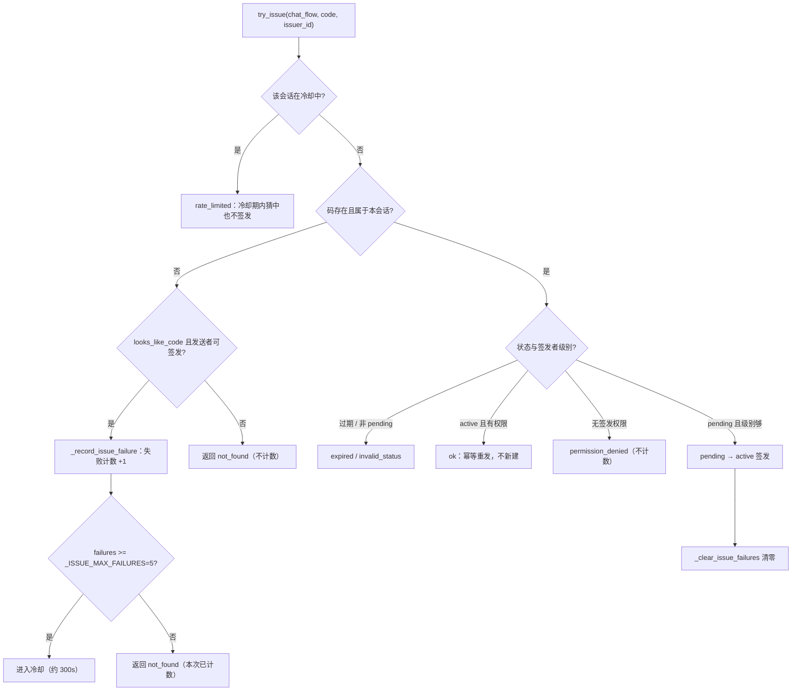
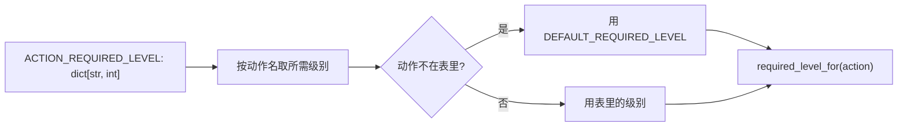
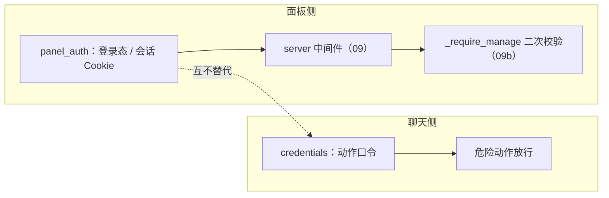
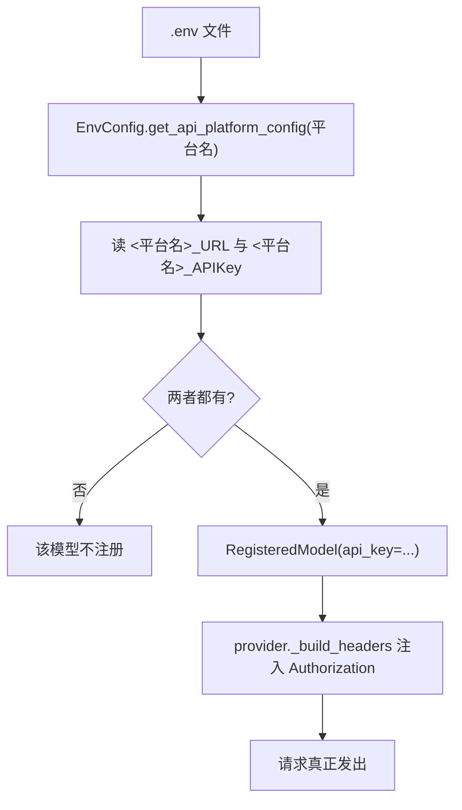
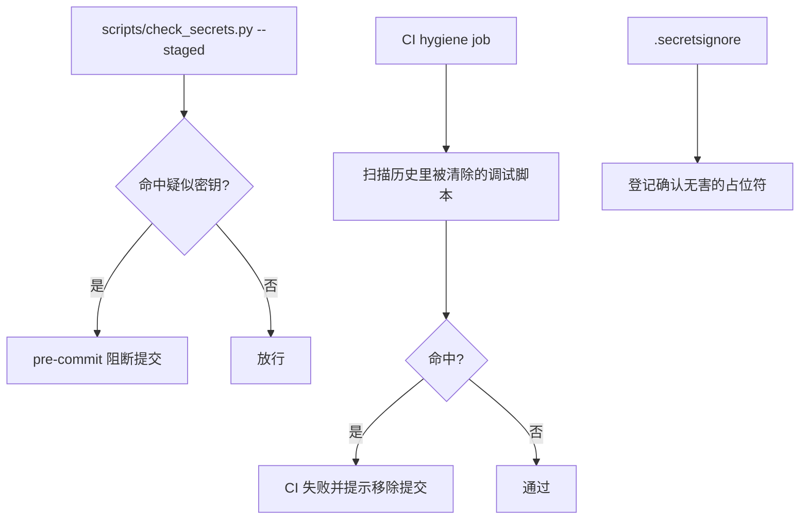

# 19 凭据、面板鉴权与安全边界

## 范围

两个**完全不同**的「认证」以及仓库的密钥防线：

* `credentials/`：**不是 API Key 仓库**，而是「聊天动作口令」——危险动作前要管理员在群里发一串码；
* `panel_auth.py` / `panel_web.py`：网页面板的登录鉴权与静态资源鉴权判定；
* 钥匙真正的来源与脱敏规则（`.env` -> EnvConfig -> RegisteredModel.api_key）、
  密钥扫描脚本与 pre-commit/CI 防线。

不在这里：面板中间件与端点的完整鉴权流见 `09-dashboard.md` / `09b-dashboard-api.md`；
沙箱路径裁决见 `06-tools-skills.md`；日志脱敏的落地见 `23-billing-stats.md`。

## 流程

## 时序

## 细节

### 凭据生命周期：create / get / consume / revoke / cleanup

四种状态要分清（`credentials/service.py`）：**不存在 / 已过期 / 已消费（一次性）/ 有效**。
`is_expired`（`model.py:72`）只看时间；`consume`（`service.py:213`）负责把一次性凭据置为已用。
`cleanup`（`:239`）是清理入口，但不保证被周期调用 —— 长期不清理不会导致功能错误（`get` 会判过期），
只是内存里会留垃圾项。

### try_issue：级别校验 + 失败冷却

`ToolPermissions` 在 `agent.tools.admin_self_authorize=true` 时对**超管本人的请求**直接放行，不会进入 `try_issue`；默认只放行私聊，群聊需列入 `admin_self_authorize_chats`。签发流程只服务其他人发起的请求。

`_ISSUE_MAX_FAILURES = 5`（`service.py:26`）与冷却窗口是**防爆破**设计：
失败 5 次后该会话在冷却期内无法再尝试签发。
计数口径是「格式与凭据码一致、且发送者本来就能签发本会话 pending 凭据的未命中」：
`looks_like_code` 为假（长度不等于 `code_length` 或含字符集外字符）只返回 `not_found`；
发送者没有签发权限同样不计数——他猜中也会 `permission_denied`，计他的数没有安全收益，
反而让普通成员能用 `hahaha` 这类恰好满足格式的日常词把签发挡住。
管线侧（`runtime/pipeline_parts/credential.py`）在会话没有 pending/active 凭据时直接短路，
普通聊天不会进入 `try_issue`。冷却期内格式合法的码由管线回「签发尝试太频繁」提示，
但只回给能签发的人、且每个冷却窗口只提示一次（`take_rate_limit_notice`）。
注意冷却键是 **chat_flow**（会话维度）不是全局 —— 一个群被冷却不影响其它群。

### ACTION_REQUIRED_LEVEL：动作到级别的映射

`credentials/model.py:23` 是唯一映射表，`required_level_for`（`service.py:277`）是唯一读法。
新增危险动作**必须**同时加表项与调用点，否则会落到 `DEFAULT_REQUIRED_LEVEL` —— 表现为
「该拦的没拦」。回执文案里明确写了「不要重试」（见 FINDINGS 06 节的凭据语义）。

### 面板鉴权与凭据的边界（两个「认证」）

两者**不通兑**：拿到面板登录态不等于能在群里执行危险动作；反之亦然。
`panel_web.py` 负责静态资源/Web 扩展的鉴权与请求权限判定（公开路径、会话、read/operate/manage），
真正的中间件在 `server.py:448`（见 `09-dashboard.md`）。

受保护扩展在未初始化密码时也拒绝数据请求。默认写操作需要 manage；普通已登录玩家的业务操作必须显式标为 operate，
例如星舰的成绩/成就写入，重置及未知写操作保留 manage。声明非法时拒绝，不能自动降级成普通操作。

面板内改密由 `api_parts/auth.py::AuthMixin.auth_password` 执行管理权限与 CSRF 校验；
`PanelPasswordStore.change_password` 在锁内核对会话 revision 和旧密码，写盘成功后才更新内存。
成功会撤销全部会话并要求重新登录；旧密码错误计入原有 IP 限流，写盘失败保留原密码。
完整分支见 `09-dashboard.md` 的改密流程。

### 钥匙真正的来源：.env -> EnvConfig -> RegisteredModel

**这里才是 API Key**，不是 `credentials/`。环境变量名大小写不敏感（`EnvConfig` 查 `os.environ`）。
面板侧对密钥有三条脱敏路径：结构化 config 载荷给空串 + `secrets_set`、TOML 原文给占位符、
只读会话隐藏 `source/raw` —— 但 `.env` 恒为掩码（`09c` 记录了两个占位符样式）。
本图与文档**不记录任何真实密钥值**。

### 密钥防线：扫描脚本 + pre-commit + CI

历史事故：`scripts/test_drawing_*.py` 等曾带硬编码密钥，已从远端历史彻底清除，
`.githooks/pre-push` 与 CI hygiene job 各有一道兜底（见 `.githooks/pre-push` 注释）。
**新增调试脚本前先读这两个文件** —— 它们列了禁止回流的文件清单。

## 关键状态

| 状态 | 谁置位 | 谁清理 | 失败时停在哪 |
|---|---|---|---|
| 凭据项 | `create` | `consume` / `revoke` / `cleanup` | 过期与已消费都按无效处理 |
| 签发失败计数 | `_record_issue_failure` | `_clear_issue_failures`（成功签发时） | 只有「格式合法 + 发送者可签发」的未命中才计数，达 5 次进入冷却（chat_flow 维度） |
| 面板登录态 | `panel_auth` 登录 | 登出、过期或成功改密后撤销全部会话 | 未登录/版本过期 401，无权限/旧密码错误 403 |
| 密钥 | `.env` + `EnvConfig` | 改 `.env` 需 reload 才重建注册表 | 平台名/密钥缺一即不注册该模型 |

## 易错点

* **`credentials/` 不是 API Key 仓库**：排查「密钥无效」不要进这个模块（FINDINGS W59）。
* **凭据不是重试型错误**：无凭据时每次同样失败，必须先 `credential__request`；
  一次性凭据一消费就 USED，时限凭据持续有效不消费（FINDINGS 06 节）。
* **签发冷却按会话**：一个群被冷却不影响其它群，但同一群内所有动作一起被挡。
* **失败计数只认「可签发者发的、像码的文本」**：`looks_like_code` 为假（长度或字符集不符）
  或发送者没有签发权限都不进 `_issue_failures`，无凭据会话更是在管线处直接短路——别用
  「每句话都算一次猜测」的直觉得出「聊几句就冷却」的结论；`hahaha`/`233333` 这类词恰好
  满足长度与字符集，真正的防线是发送者权限门与无凭据短路。
* **新增危险动作必须登记 `ACTION_REQUIRED_LEVEL`**：漏登记会落到默认级别，表现为「该拦的没拦」。
* **面板登录态与凭据不通兑**：两套体系独立判定。
* **密钥只从 `.env` 来**：面板保存后需要 reload 才让注册表用上新密钥。
