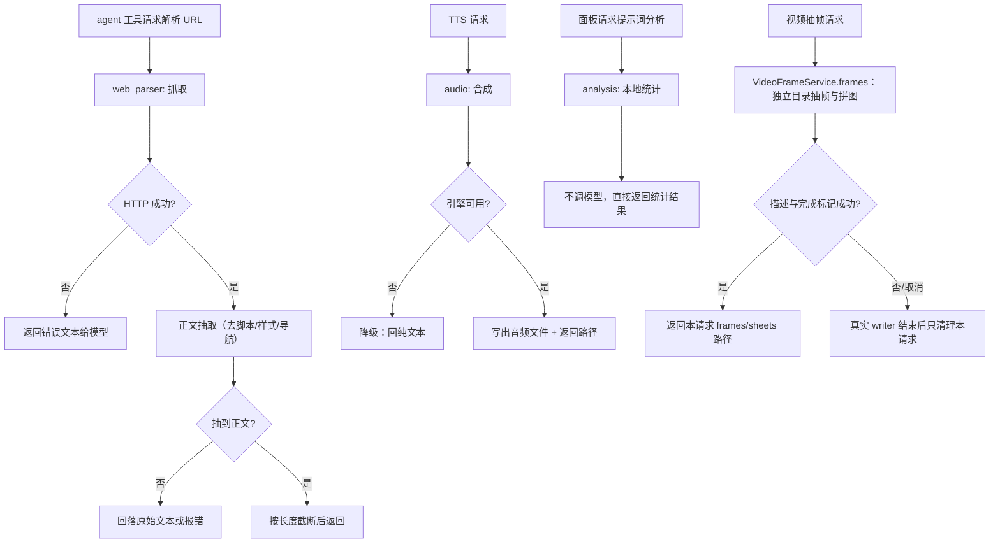
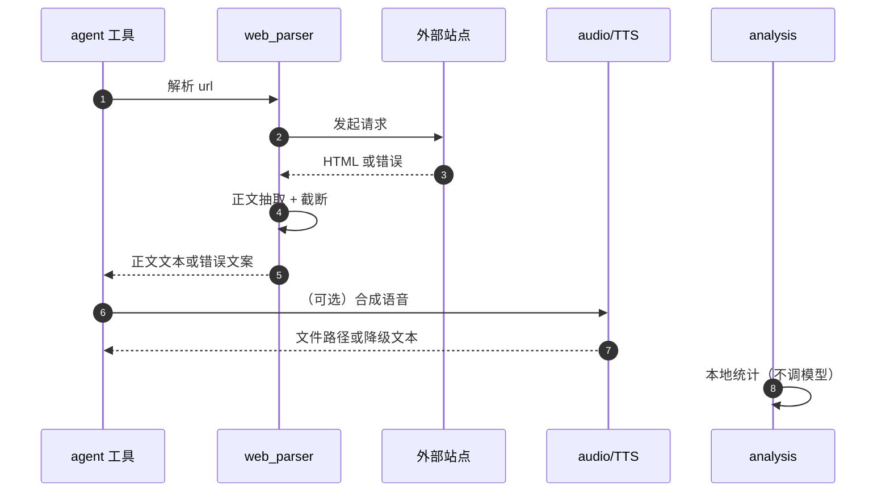
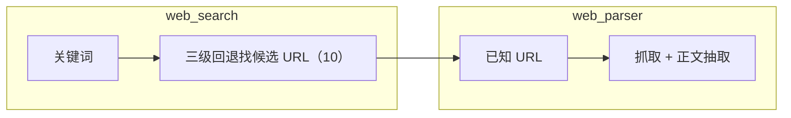
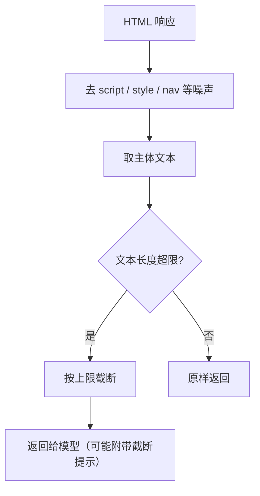
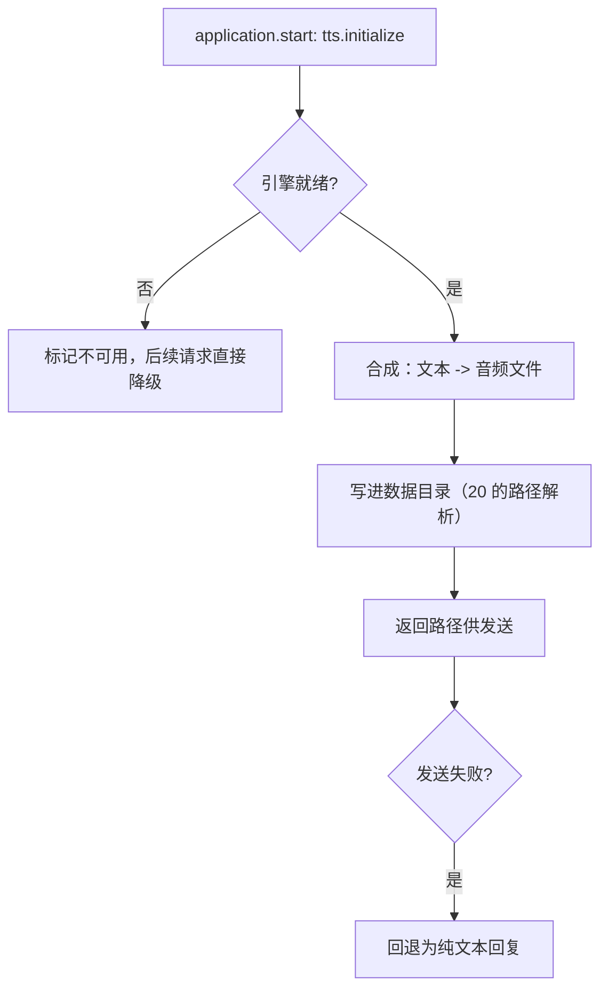
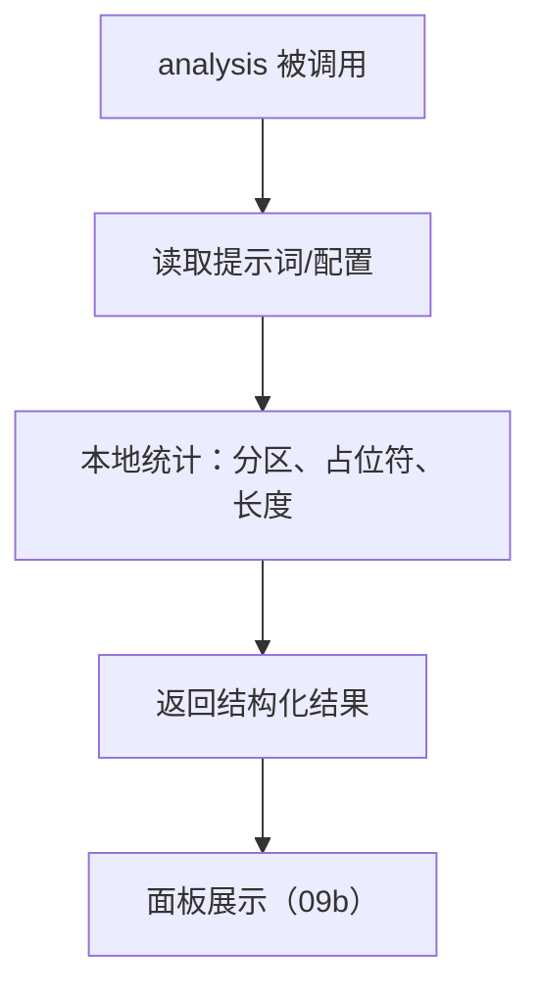
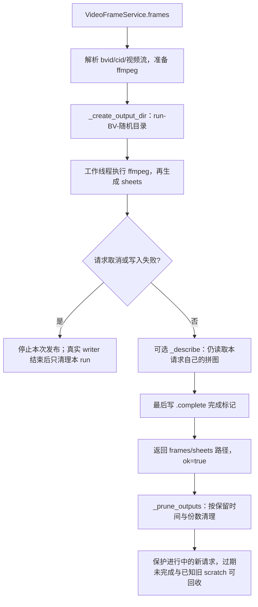

# 21 网页解析 · 音频 · 本地分析 · 视频抽帧

## 范围

与外部内容打交道的抓取、音频和视频处理子系统：

* `web_parser/`（5 文件 543 行）：把 URL 抓成可读正文，供 agent 工具使用；
* `audio/`（3 文件 466 行）：TTS 与音频产物；
* `analysis/`（3 文件 334 行）：本地提示词分析（不调模型）；
* `bilibili/video_frames.py`：视频流解析、独立目录抽帧/拼图、视觉描述与取消后的工作线程清理；
  B站客户端、字幕和互动接口见功能文档 `docs/04-功能文档/B站与跨平台.md`。

不在这里：联网搜索的三级回退见 `10-web-search.md`（与网页抓取是两条链路）；
卡片与音频渲染见 `13-render-cards.md`；工具面见 `06-tools-skills.md`。

## 流程

## 时序

## 细节

### 网页抓取与搜索链路的区别

两者**不共享实现**：`web_search` 负责「找到 URL」（HTTP -> 浏览器 -> DDG 三级回退），
`web_parser` 负责「把已知 URL 变成正文」。排查「搜到了但读不出内容」要进 `web_parser`，
排查「搜不到」进 `web_search`。

### 正文抽取与截断

抽取失败时**回落到原始文本或错误文案**（而不是抛异常）—— 这是给模型看的工具，
错误也要以文本形式返回，模型才能继续决策（与 `06` 的工具失败语义一致）。

### 音频 / TTS：可用性与降级

TTS 初始化在 `start()` 的第 2 步（见 `01-startup-shutdown.md`），**初始化失败不阻断启动**。
降级路径是「回纯文本」，所以用户看到「没有语音」时先确认引擎是否就绪，而不是看发送环节。

### 本地分析：不调模型的统计

关键性质：**它不调用模型**（面板「分析」页因此不会产生费用，也不受速率限制）。
它读的是装配期的提示词结构，属于诊断工具 —— 排查「提示词为什么这么长」可以从这里入手。

### 视频抽帧：每请求独立目录，真实写入完成后清理

每个请求的路径在生成后不再重命名，后续同 BV 请求不会覆盖正在描述或读取的结果。
Windows 读句柄不允许删除共享时，整目录改名会失败；发布不再依赖这个动作。
取消 asyncio 等待不等于结束真实写线程，清理必须等真实写入结束；清理不发布半成品，
也不删除其他请求的结果。完成标记写入失败时整次请求失败。

## 关键状态

| 状态 | 谁置位 | 谁清理 | 失败时停在哪 |
|---|---|---|---|
| 抓取结果 | 每次请求实时获取 | 不缓存（按调用方决定） | 失败以错误文本返回给模型 |
| TTS 引擎就绪 | `tts.initialize`（启动第 2 步） | 停机 | 未就绪即降级为纯文本，不阻断启动 |
| 分析结果 | 每次调用现算 | 不缓存 | 本地统计不会失败（除文件读取） |
| 抽帧目录 / `.complete` | 每请求创建独立目录，描述结束后写标记 | 失败/取消后的真实 writer 清理，成功结果按 TTL/份数回收 | 不返回半成品，不覆盖旧请求 |

## 易错点

* **抓取与搜索是两条链路**：别把「读不出正文」当成搜索失败。
* **抽取失败返回文本而不是抛异常**：工具错误以文本形式回灌，模型据此继续决策。
* **TTS 初始化失败不阻断启动**：表现为「没有语音但一切正常」，先查引擎就绪状态。
* **本地分析不调模型**：面板「分析」页不计费、不受限速。
* **同 BV 不共享发布路径**：第二次抽帧可能在第一次视觉 await 期间完成，不能替换第一份拼图。
* **Task 取消不等于线程退出**：退出循环时仍需等待真实 writer 的清理，不能靠 asyncio Task.done 判断写入结束。
